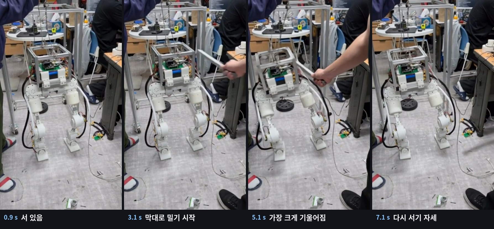
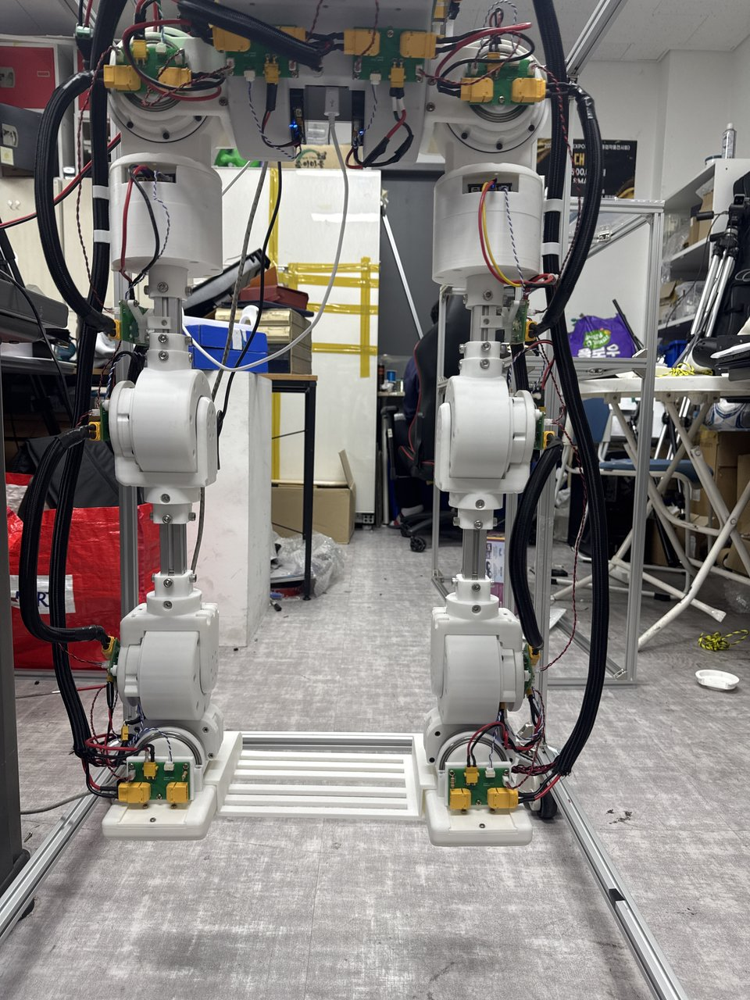
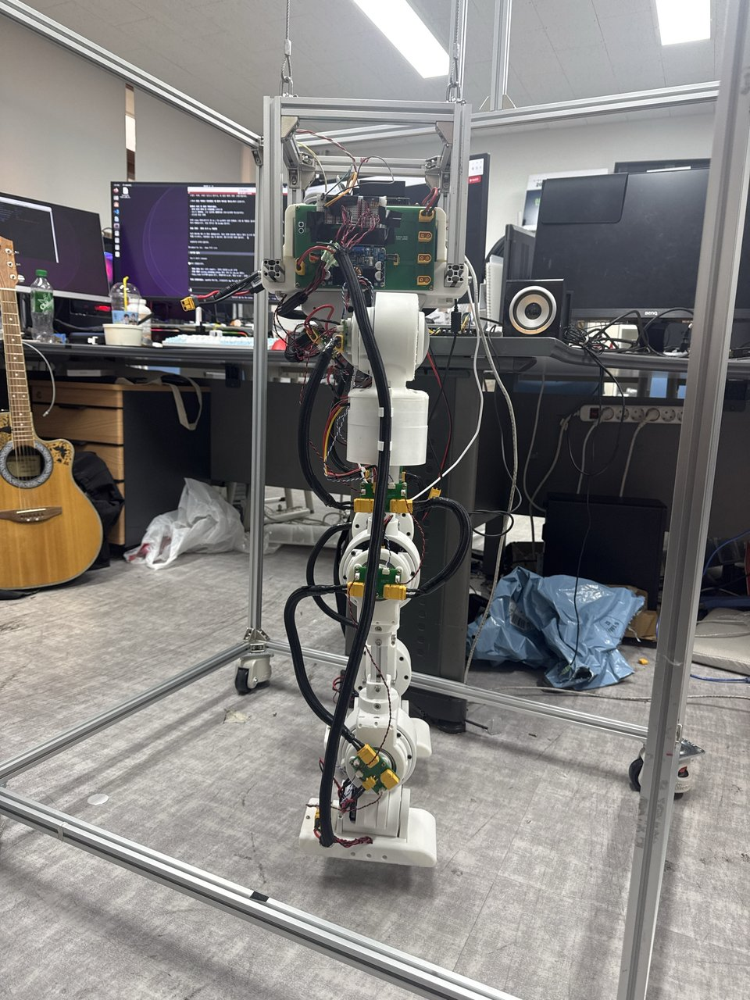
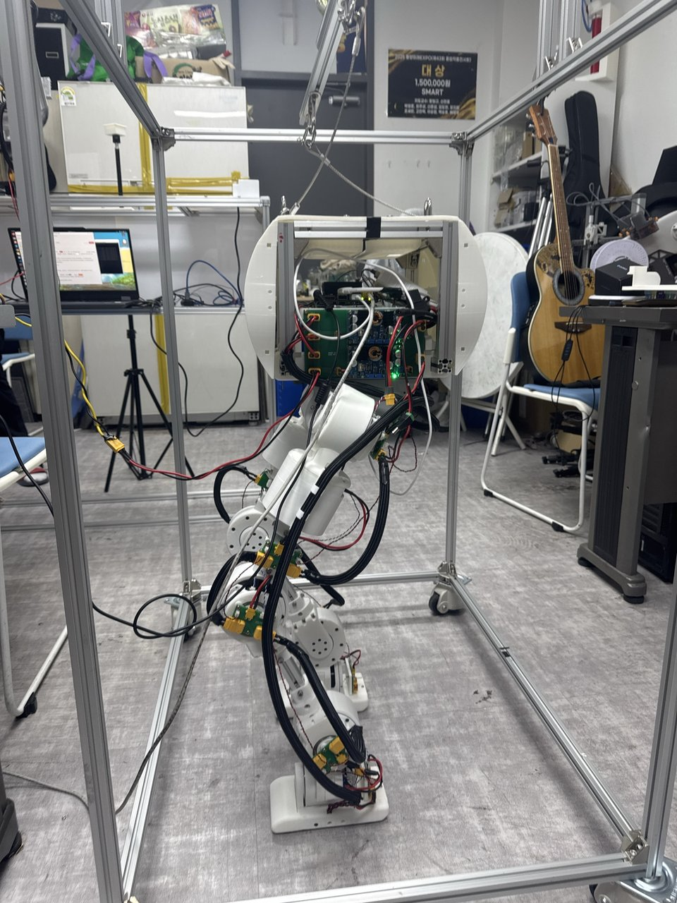
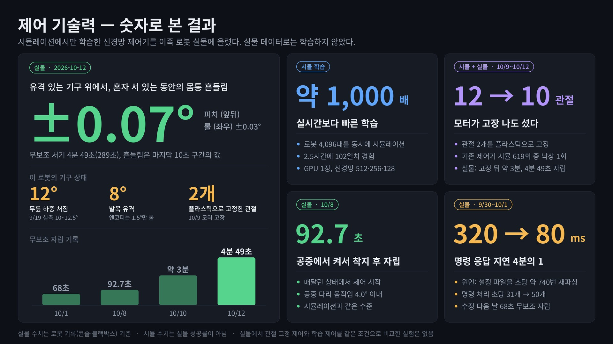

# 12DOF Humanoid Leg — 실물 이족 하체 + 강화학습 서기·외란 대응

> **프로젝트 종료 (2026-10-14).** 외란(막대 밀기) 대응까지 실물에서 성공하고 마무리했다.
> 전체 정리는 **[`프로젝트_종료보고서.md`](프로젝트_종료보고서.md)**, 시기별 상세 이력은 [`docs/history/`](docs/history/).

12축 AK MIT 모터 하체를 젯슨에서 CAN으로 직접 구동하고, Isaac Lab에서 학습한 정책으로
공중/매달림 → 착지 → 무보조 서기 → 밀려도 넘어지지 않는 서기까지 실물에서 해냈다.



## 결과

| 날짜 | 실물 결과 |
|---|---|
| 2026-09-28 | 홀드만으로 무보조 101 s (영상 확인) |
| 2026-10-01 | 정책 무보조 서기 68 s |
| 2026-10-08 | 공중에서 정책 시작 → 착지 → 무보조 서기 92.7 s |
| 2026-10-12 | 서기 289 s, 제자리걸음 4.35 s |
| **2026-10-14** | **막대 밀기 외란 대응 성공** — [`reports/real_1014/`](reports/real_1014/) |

최종 정책 구성: 3단 합성 러너 `AIR → KE ⇄ W3`, KE = 서기 G21a-11300 ⇄ 회복 G24Ra-21793 (IMU 감지기 전환).

| 실물 하체 (09-07) | 매달림 장치 (09-08) | 무보조 서기 101 s (09-28) |
|---|---|---|
|  |  |  |



그림 전체와 출처: [`docs/images/`](docs/images/).

## 구성

- 실물 런타임: `jetson/scripts/` — stage8 12축 노드, RL 브리지, 운영 콘솔(젯슨 8800), `robotctl`
- 학습·평가: `rl_walking/` — Isaac Lab 2.3.2 환경, 평가기, 배포 러너(`rl_walking/deploy/`)
- 정책 레지스트리: `models/`
- 시험 기록·판정: `reports/`, 실행 카드·절차: `docs/`
- 작업 원칙: [`CLAUDE.md`](CLAUDE.md)

## 실물 기동

- stage8 단독 제어 퀵스타트: [`docs/stage8_12axis_real_control_quickstart.md`](docs/stage8_12axis_real_control_quickstart.md)
- 매달림→자립 절차: [`docs/hang_to_stand_실물절차.md`](docs/hang_to_stand_실물절차.md)
- 안전 규칙(회수 순서·영점·PID 종료)은 `CLAUDE.md` "실물 안전" 절을 먼저 읽는다.

CAN bringup (1 Mbps):

```bash
sudo ip link set can0 down
sudo ip link set can0 type can bitrate 1000000 restart-ms 100
sudo ip link set can0 up
```

## 저장소 메모

- 이 GitHub 저장소는 **공개본**이다. 원본 작업 저장소의 이력 전체(커밋 1,604개)를 그대로 두고 아래만 뺐다.
  - 원본 로그: `*.jsonl`(실물 블랙박스·세션 타임라인·시뮬 블랙박스 덤프), `reports/**/raw/`
  - 렌더 프레임 PNG(`log_picture/video_*/`), 50 MB 넘는 파일(화면 녹화 1개)
  - 젯슨·핫스팟 접속 암호는 가렸다. 스크립트에서는 `JETSON_PW`·`JETSON_SUDO_PW` 환경변수로 넣는다.
  - 사진·영상의 촬영 위치·기기 메타데이터

  그래서 일부 보고서의 원본 로그 경로는 열리지 않는다. 문서에 적힌 커밋 해시는 공개본 기준으로 고쳐 두었다.
- 브랜치는 `main` 하나, 종료 시점 태그 `project-close-1014`. 옛 작업 브랜치(`archive/*` 태그)는 원본 저장소에만 있다.
- `*.npz` 평가 덤프와 렌더 프레임 폴더, `logs/`·`outputs/`(체크포인트)는 저장소 밖(`.gitignore`).
- `건들지마 메모장이야.txt` 는 수정하지 않는다.
